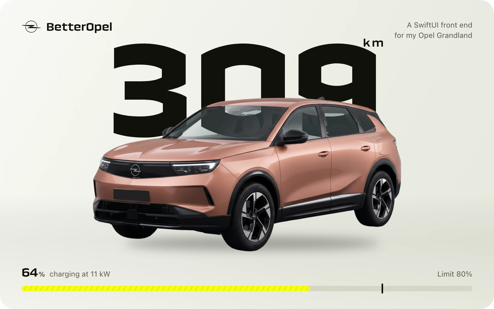

<p align="center">
  
</p>

BetterOpel is the app I wanted for my Opel Grandland. A native SwiftUI front end that puts range, charging and climate one tap away, and makes each of those taps feel like it touched something.

It talks to my own car through a small server on a Mac mini at home, and to a simulated Grandland for everyone else. An independent personal project, not made by or affiliated with Opel or Stellantis.

<p align="center">
  
</p>

## One idea per screen

- **Car.** The range is the largest thing in the app, and the car stands in front of it. The glass in the render is translucent, so the figure reads through the windscreen.
- **Charge.** The battery is a single slab. The lit part is what it holds, the hatched part is what it will add, and the marker is the limit.
- **Climate.** One button. The rest of the screen reports what that button did.
- **Trips.** Every route is drawn as its own small mark, so a list of drives reads as a list of places.

## Motion that says something

<p align="center">
  
  
</p>

**Refresh** sends a bead of clear glass down both edges of the screen. It rests on the top edge while the car wakes up and climbs back when the answer lands. There is no spinner.

**The charge limit** is a membrane pinned at both ends. Drag it and its belly lags behind your finger, then swings through and settles. The value flag hangs off it on a neck that stretches.

<p align="center">
  
  
</p>

**Climate** is a single tap. The outline of the bay is the progress, and warm air only moves through the windscreen and the rear window, because the roof is solid.

**Ready by** sets a time by pulling a ruler under a needle that bows like the charge marker. You paint the days with a finger. Neighbouring days run together into one bar, and pull apart on a thinning neck when you take one out.

Each of these is a Metal shader driven from SwiftUI and timed with springs and keyframes, not a looping animation. All of them switch off with Reduce Motion.

## Old data looks old

<p align="center">
  
</p>

Five minutes after the car last reported, the range starts to wear from the top down into grain. After an hour it is as worn as it gets, and a fresh reading makes it whole again. You can tell how far to trust the number without reading a timestamp.

## Outside the app

<p align="center">
  
</p>

A Lock Screen button starts the climate and reports each step in one notification that rewrites itself: sending, waking the car, sent, running. Timed starts run on the server, so they fire while the phone sleeps and don't rely on the programmes stored in the car. Widgets, Control Center toggles, Shortcuts and a charging Live Activity all read the same shared state.

## Three colourways

<p align="center">
  
</p>

Volt is the default, yellow on white like Opel's own. Copper is the paint on my car. Petrol is the cool one. Each colourway brings its own surfaces and inks for light and dark, not only a new accent, and the widgets and Live Activity follow it.

## How it got here

The first version leaned on Liquid Glass and looked like a well-made Apple sample. Most of the work since has been replacing borrowed parts with ones made for this car: Opel's black and yellow instead of glass, a navigation bar and icon set drawn for the app, a render of my actual car instead of a stock one, and one-tap climate instead of a screen of controls. Some effects went in and came back out. The [design notes](docs/DESIGN.md) go through it step by step.

## Where to look in the code

| What | Where |
| --- | --- |
| Colour roles for the three colourways | [`Shared/Theme.swift`](Shared/Theme.swift) |
| Range, car and studio composition | [`HeroStage.swift`](BetterOpel/Features/Home/HeroStage.swift) |
| The refresh lens and its choreography | [`LensWave.swift`](BetterOpel/DesignSystem/LensWave.swift) |
| The liquid limit marker | [`BatterySlab.swift`](BetterOpel/Features/Charge/BatterySlab.swift) |
| One-tap climate | [`ClimateView.swift`](BetterOpel/Features/Climate/ClimateView.swift) |
| Ready-by editor, time tape and week ink | [`WarmUpViews.swift`](BetterOpel/Features/Climate/WarmUpViews.swift) |
| Every shader | [`Shaders.metal`](BetterOpel/DesignSystem/Shaders.metal) |
| Springs and haptics | [`Motion.swift`](BetterOpel/DesignSystem/Motion.swift), [`Haptics.swift`](BetterOpel/DesignSystem/Haptics.swift) |
| State, pending commands, confirmation | [`VehicleModel.swift`](BetterOpel/App/VehicleModel.swift) |
| Lock Screen start and its notifications | [`Preheat.swift`](Shared/Model/Preheat.swift) |
| Widgets, controls, Live Activity | [`BetterOpelWidgets/`](BetterOpelWidgets), [`Shared/Intents/`](Shared/Intents) |

No third-party Swift packages. [XcodeGen](https://github.com/yonaskolb/XcodeGen) builds the two-target project from [`project.yml`](project.yml).

## Run the demo

You need a Mac with Xcode 26.1 or newer and an iOS 26.1 simulator. No car, account or server.

```bash
git clone https://github.com/builtbymatti/BetterOpel.git
cd BetterOpel
brew install xcodegen
xcodegen generate
open BetterOpel.xcodeproj
```

Run the BetterOpel scheme on an iPhone simulator. The demo car charges at 40 times real speed so a session visibly moves. Settings switches the colourway and resets the demo. To install on your own phone, set your own bundle identifiers and App Group as described in the [development notes](docs/DEVELOPMENT.md).

## With a real car

The app talks to an owner-hosted [psa_car_controller](https://github.com/flobz/psa_car_controller), which keeps the MyOpel sign-in out of the app. Mine runs on a Mac mini, reachable from my phone over Tailscale. Next to it runs a small scheduler from this repo that handles the ready-by times and the Lock Screen start. Setup is in [`Server/README.md`](Server/README.md). Building or running the demo never touches a server or an account.

## Notes

- The images and clips were captured from the current build in the iOS simulator, with demo data. They are set in Technor from Fontshare, whose licence doesn't allow the font files to be shared here, so the public build uses Oxanium (SIL OFL) instead. To match the images, add Technor to `BetterOpel/Resources/Fonts` and swap the names in `DisplayWeight` in `Shared/Theme.swift` and in `UIAppFonts` in `project.yml`.
- The car renders were generated from photos of my own car, not taken from Opel.
- It runs on my iPhone against my car. Whether a sleeping car accepts a remote climate start is up to the car, and the app says so rather than pretending. I haven't audited VoiceOver across every screen.
- Code and docs are [MIT](LICENSE). Fonts, maps, trademarks and the renders keep their own terms, listed in [`THIRD_PARTY_NOTICES.md`](THIRD_PARTY_NOTICES.md).

Made by [builtbymatti](https://github.com/builtbymatti).
