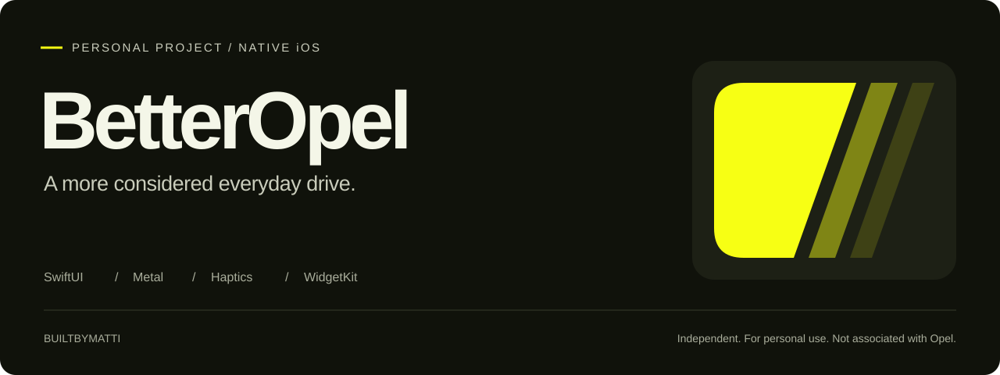
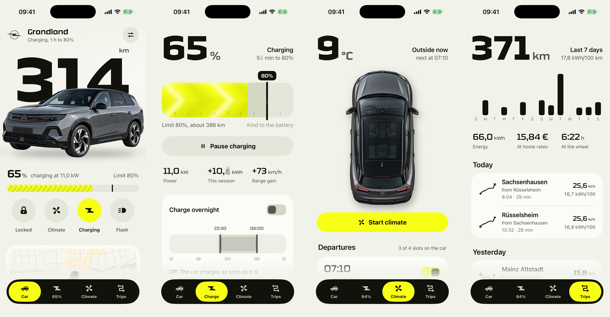
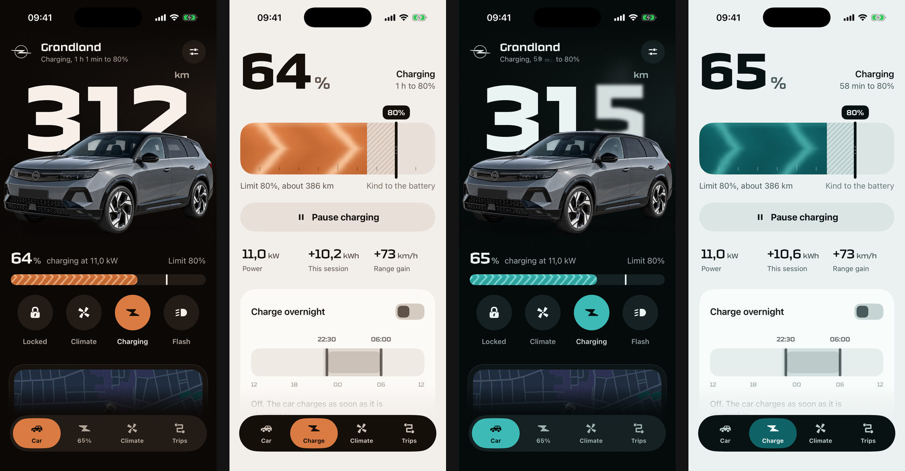
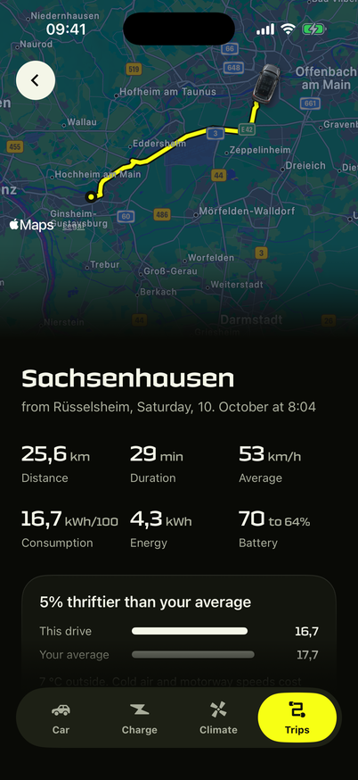

<p align="center">
  
</p>

<p align="center">
  <a href="https://github.com/builtbymatti/BetterOpel/actions/workflows/ci.yml"></a>
  
  
  <a href="LICENSE"></a>
</p>

# Your car. A little more considered.

I built BetterOpel for my own Opel Grandland: a native iOS interface that puts range, charging and climate within easy reach. This repository presents the interface, the decisions behind it, and the SwiftUI code that makes it work.

**Independent personal project.** Built for my private use and shared as a frontend portfolio piece. Not associated with, affiliated with, sponsored by, or endorsed by Opel, MyOpel, or Stellantis. It is not an official Opel app.

[Design walkthrough](docs/DESIGN.md) · [Architecture](docs/ARCHITECTURE.md) · [Run locally](#try-the-demo) · [Privacy](PRIVACY.md)

## Four screens. One visual language.



The car sits in front of the range, instead of beside another dashboard tile. Charging gets a physical, draggable battery. Climate shows air moving through the cabin. Trips use the shape of each route as their identifier.

All gallery images use demo fixtures. The public destinations, sample routes, battery readings and driving statistics are illustrative, not a personal vehicle export. These captures show an earlier UI revision with Technor. The public build uses the openly licensed Oxanium and includes later connection and refresh work.

| Car | Charge | Climate | Trips |
| --- | --- | --- | --- |
| Range, battery, hold-to-unlock, lights and parked location. | Drag the limit, pause a session, plan an overnight window. | Start preconditioning, see its progress, plan a ready-by time. | Read distance and consumption, then follow the route on a map. |

## The details are the project

- **Motion with a purpose.** Metal shaders move energy through the battery, draw cabin airflow and sweep light over the bodywork when a lock changes. A refresh lens bends the hero rather than adding another spinner.
- **Controls that feel physical.** Springs can be interrupted. Charge limits have detents. Unlocking takes a deliberate hold. Custom Core Haptics patterns mirror a lock actuator and a charging ramp on supported hardware.
- **A system beyond the screen.** App Groups share vehicle state with WidgetKit, App Intents, Control Center and a charging Live Activity. A change in one surface can be picked up in another.
- **Three complete colourways.** Volt, Copper and Petrol each have their own surface and text tokens in light and dark appearances. The choice carries through to widgets and the Live Activity.
- **An honest connection model.** Demo, connecting, live and offline states are distinct. Sent commands can wait for the car's confirmation instead of immediately pretending to have succeeded.



<details>
<summary><strong>Open the trip detail</strong> — route, energy and context</summary>
<br>


The route draws onto MapKit, while consumption is compared with the demo car's average. Elevation is generated for the demo; the interface does not imply that simulated values came from the vehicle.
</details>

## Try the demo

You do not need a car, account, server or credentials. The app starts with a simulated Grandland, and the simulation runs locally. MapKit can fetch map tiles.

**Requirements:** macOS with Xcode 26.1 or newer, an iOS 26.1+ simulator, and [XcodeGen](https://github.com/yonaskolb/XcodeGen). The public project uses example bundle identifiers and contains no signing-team ID.

```bash
git clone https://github.com/builtbymatti/BetterOpel.git
cd BetterOpel
brew install xcodegen
xcodegen generate
open BetterOpel.xcodeproj
```

Select **BetterOpel**, choose an iPhone simulator, and run. Visit Settings to change the colourway, switch to the plug-in hybrid demo, or restart the simulation. Charging advances at 40× speed so a session visibly progresses.

For a simulator build from the command line:

```bash
./scripts/build.sh
# Or choose another installed simulator:
SIMULATOR_NAME="iPhone 17" ./scripts/build.sh
```

For a physical phone, set your own bundle identifiers, signing team and matching App Group in both targets and `SnapshotStore.appGroup`. See the [development guide](docs/DEVELOPMENT.md).

## Where to look in the code

| What to inspect | Entry point |
| --- | --- |
| Shared colour roles and three themes | [`Shared/Theme.swift`](Shared/Theme.swift) |
| Range typography, car lighting and hero composition | [`HeroStage.swift`](BetterOpel/Features/Home/HeroStage.swift) |
| Battery gestures and charge-limit feedback | [`BatterySlab.swift`](BetterOpel/Features/Charge/BatterySlab.swift) |
| Energy, airflow, lighting and distortion | [`Shaders.metal`](BetterOpel/DesignSystem/Shaders.metal) |
| Spring motion and tactile feedback | [`Motion.swift`](BetterOpel/DesignSystem/Motion.swift), [`Haptics.swift`](BetterOpel/DesignSystem/Haptics.swift) |
| Observable state, pending commands and confirmation | [`VehicleModel.swift`](BetterOpel/App/VehicleModel.swift) |
| Demo/network boundary | [`VehicleAPI.swift`](Shared/Model/VehicleAPI.swift), [`Connection.swift`](Shared/Model/Connection.swift) |
| Widgets, system controls and Live Activity | [`BetterOpelWidgets/`](BetterOpelWidgets), [`Shared/Intents/`](Shared/Intents) |

No third-party Swift package dependencies. XcodeGen creates the two-target project from [`project.yml`](project.yml).

## A real connection, when configured

The network client talks to an owner-hosted [psa_car_controller](https://github.com/flobz/psa_car_controller) server. It does not sign in to MyOpel from the app. The repository also includes a local fake server and an optional ready-by climate scheduler.

The frontend is the focus here. Vehicle command availability depends on the car and server. Preconditioning is an on/off remote command, so there is no invented temperature dial. Ready-by schedules use the companion scheduler; the server cannot edit the departure programmes stored in the car.

See [`Server/README.md`](Server/README.md) for the optional integration. Running the app or building the demo never installs a server or connects to an account.

## Verification and limits

The public source has been built locally with **Xcode 26.3 for the iOS 26.2 simulator**. Repository privacy checks and the fake-server integration tests are run locally and in CI. See [validation notes](docs/DEVELOPMENT.md#validation) for the exact scope.

The supplied gallery was captured from a previous demo build. Hardware haptics, real-car commands, Siri, VoiceOver and the full set of system surfaces have not been revalidated for this public snapshot. This is a personal project, not a supported replacement for the official app.

## Credits and license

Original code and documentation: [MIT](LICENSE). The public build bundles Oxanium by Severin Meyer under the [SIL Open Font License](BetterOpel/Resources/Fonts/OFL.txt). Earlier gallery captures use Technor; those font binaries are not redistributed. Vehicle renders are generated, not official Opel photography. Trademarks, maps, fonts and other third-party material retain their own rights; see [asset credits](THIRD_PARTY_NOTICES.md).

Made by [builtbymatti](https://github.com/builtbymatti), for personal use with my Grandland.
