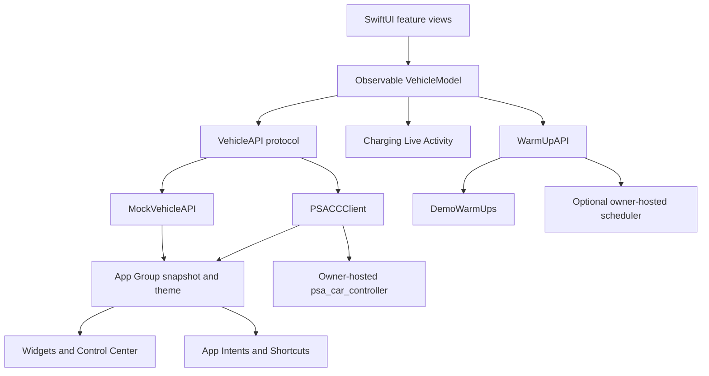

# Architecture

Two Xcode targets: the SwiftUI app and a WidgetKit extension. Both compile the shared models, theme, render helpers and intents. No third-party Swift packages are required.



## Ownership and effects

`VehicleModel` is a main-actor observable object, owned at the app entry point and injected into the view hierarchy. Features read snapshots and issue commands through it. The model tracks pending work, notices, confirmation expectations and lifecycle polling. Widgets and intents use the shared service selector and snapshot store rather than the app's view model.

`VehicleService` chooses `MockVehicleAPI` when there is no configured server and VIN, and `PSACCClient` when both are present. Demo and live snapshots use separate keys. In the public copy, example bundle and App Group identifiers keep this installation separate from the author's private app.

## Directory map

```text
BetterOpel/
  App/                lifecycle, tabs, observable model, place naming, shortcuts
  DesignSystem/       components, Metal shaders, motion and haptics
  Features/           Home, Charge, Climate, Trips, Settings
  Resources/          typefaces, icon and launch colours
Shared/
  Model/              models, simulation, network transport and scheduling
  Intents/            vehicle actions and Live Activity controller
  Theme.swift         semantic colour roles and shared theme store
BetterOpelWidgets/    widgets, Control Center and Live Activity extension
Server/               optional owner-hosted services and local fake server
docs/                 design decisions and development notes
scripts/              portable build, demo capture and privacy guard
```

## Rendering

SwiftUI composes the screens and Metal handles small, targeted visual effects through `colorEffect` and `layerEffect`. The shaders cover studio lighting, flowing energy, the planned-charge hatch, cabin airflow, the touch ripple, the refresh lens, the worn stale reading, the liquid limit marker, the week ink and the ready-by warm band. Generated vehicle renders are ordinary bundled assets.

## Connection boundary

The app stores its server address, VIN and cached vehicle readings locally in the App Group. These are private runtime values, not repository configuration. The server manages MyOpel authentication outside the app. MapKit and live place naming can make requests to Apple's services.

The Python fake server is a development fixture with an obviously synthetic vehicle identifier. It binds to loopback by default and does not require account credentials. The companion scheduler is separate from the PSACC server and maintains its own local schedule state.

## Deliberate limits

The network client reflects JSON shapes observed with PSACC 3.7.9. Compatibility with every server version or vehicle has not been established. Commands, haptics, Siri and background execution depend on device and platform behaviour. The architecture is documented from the source; it is not a guarantee of reliable remote vehicle control.
