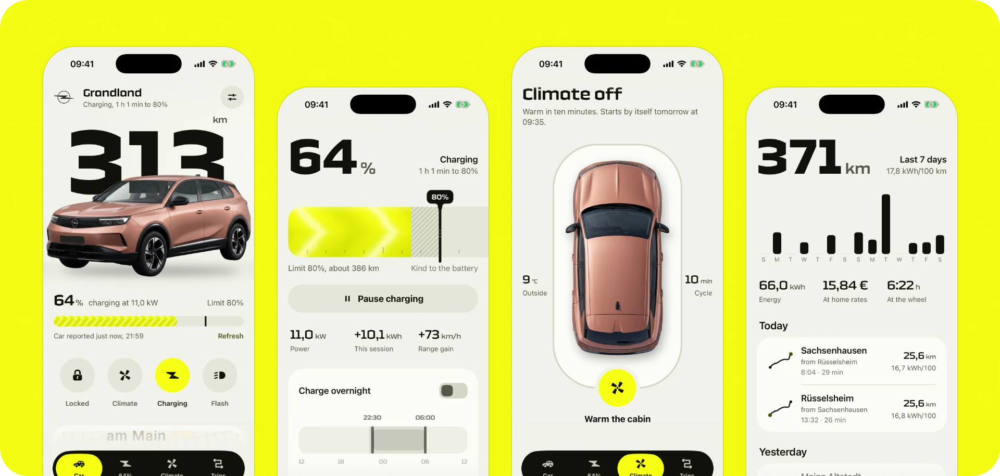
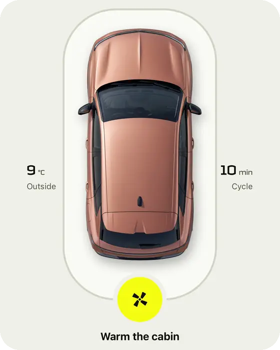
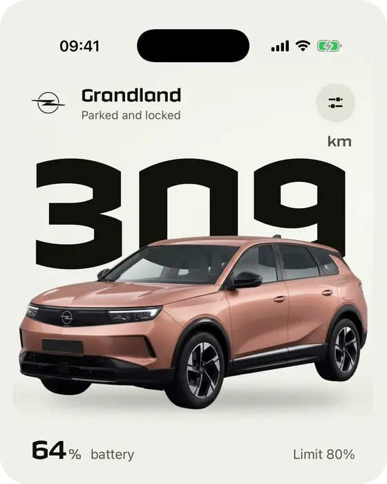
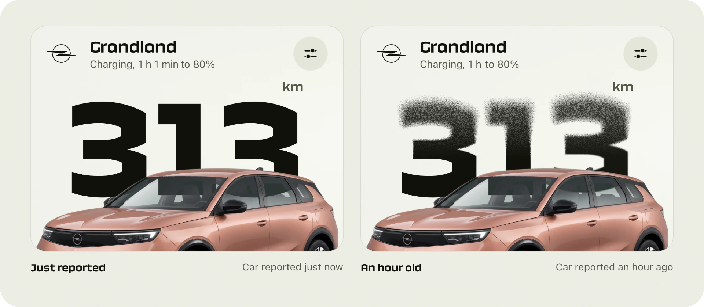
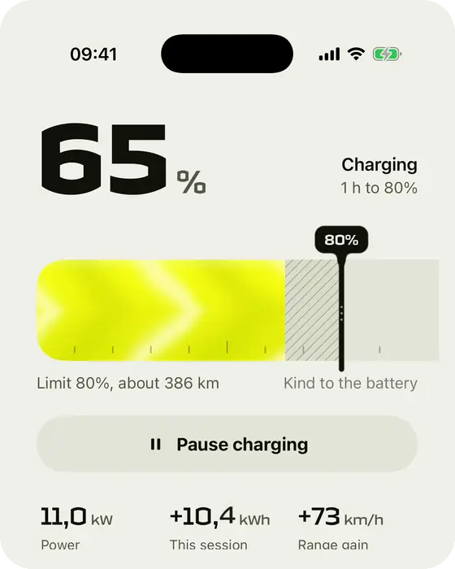
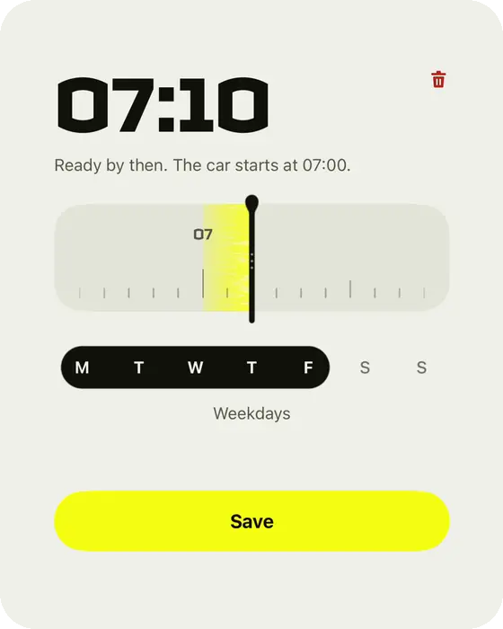
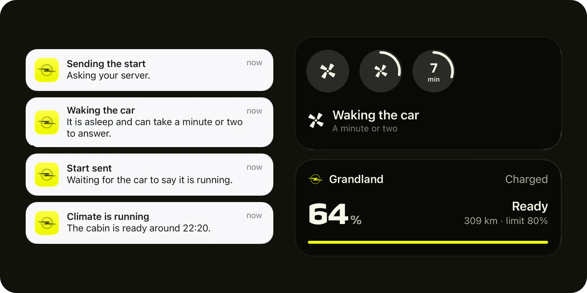
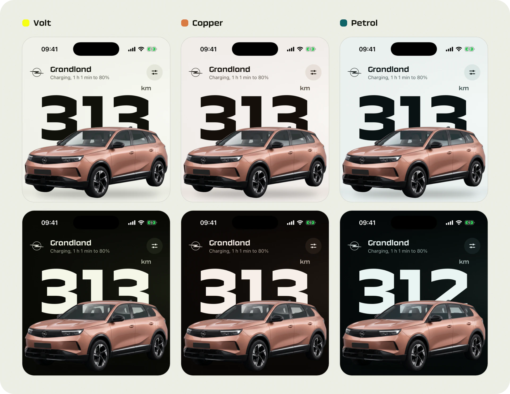

# Design notes

How BetterOpel got from a first draft to what is on my phone, in the order it happened. Each step was a decision against something that worked but felt borrowed.

## The brief

A front end for my Grandland that I would rather open than the official app. Native, fast, and physical: every control should answer the finger with motion, sound or touch, and every effect should explain something about the car. The car's data comes from psa_car_controller, so the app only has to be good at the interface.

## Less Apple, more Opel

The first pass used Liquid Glass for buttons, sheets and the tab bar. It was tidy and it was anybody's app. So the glass went and Opel's own language came in: a solid black navigation capsule with the current tab picked out in yellow, filled yellow primary buttons, and a squared display face for every figure. The tab bar is the app's own, so the system bar is hidden on every screen and each screen keeps its last row clear of the capsule.

The icons are drawn for the app rather than taken from a pack: one stroke weight, one corner, one grid. Small details hold the system together. The switch's knob and track share a centre for their corner radii, so the gap around the knob is even all the way round.

## The car is the hero

The first screen is one composition: the range set as large as the screen allows, the car standing in front of it on a lit studio floor. The studio is a shader that takes its tones from the colourway, so the stage and the page are one surface.

The car is my car. The first render was a recolour of a generic model, with the wrong body. I regenerated it from my own photos, cut it out with proper matting instead of a quick mask, and made the glass translucent so the range reads through the windscreen. A later version swept light over the headlights when the car locked. It needed the lamps cut out of the render, and the cut looked worse than having no effect, so it went. The car now just settles on its springs when it locks.

## Climate is one tap

The climate screen started as controls. It became a single bay around the car seen from above, with one button at its base. The headline, the outline of the bay and the air in the cabin all report one state: off, sending, waking the car, warming with the minutes left, ready. Warm air only moves through the windscreen and the rear window, because the roof is solid. "Waking the car" is its own state because a sleeping car takes a minute or two to answer, and the screen should say so instead of pretending it worked.

## Waiting is part of the design

A remote command takes a while to reach the car, and readings get old. Two effects deal with that.

**The refresh lens.** A refresh used to be a spinner. Now a bead of clear glass rides down both edges of the screen, bending what is under it, waits on the top edge while the car is asked, and climbs back when the answer arrives. If nothing newer comes back, the glass shivers and lets go. It has no colour of its own, only refraction and a thin line of light, so it doesn't read as a glow.

**Old data looks old.** The range wears into grain from the top down as the reading ages, and a fresh reading makes it whole. It replaces having to read "updated 47 minutes ago".

## Liquid controls

Drag controls behave like a liquid. The charge-limit marker is a membrane pinned at both ends: its belly lags behind the finger, swings through and settles, and the hatched span it ends shears along the curve. The value flag is part of the same ink and trails on a neck that thins as it stretches.

The ready-by editor reuses that physics. The time is a ruler pulled under a fixed needle that bows in the stream, with the ten minutes the car runs drawn as a warm band behind it. The days are painted with one stroke, and chosen neighbours run together into a bar that necks apart when a day in the middle is taken out.

  
  

## Schedules belong on the server

The car stores its own climate programmes, but the server can only overwrite them, not read them back, and I wanted every start to report how it went. So timed starts moved to a small scheduler next to the car server. It wakes the car, sends the start, watches for the car to confirm and asks once more if it doesn't, then keeps the outcome so the app can show "started at 07:00, the car confirmed". It fires whether or not the phone is awake.

The Lock Screen gets one button that starts the climate through the same path. Each step arrives as a notification that rewrites itself: sending, waking the car, sent, running.

## Colourways

Volt is the default because it sits closest to Opel's own yellow on white. Copper matches my car's paint and Petrol is the cool alternative. Each one defines its own canvas, surfaces, wells and inks for light and dark, and separate tokens for accent text and filled controls, so a bright fill never has to double as body text. The choice is stored in the App Group, so widgets and the Live Activity follow it.

## What this is not

There are no usage numbers here and no claims I haven't checked. The demo's routes are public places near Rüsselsheim, its elevation is generated, and charging runs faster than real time so a session visibly moves.
