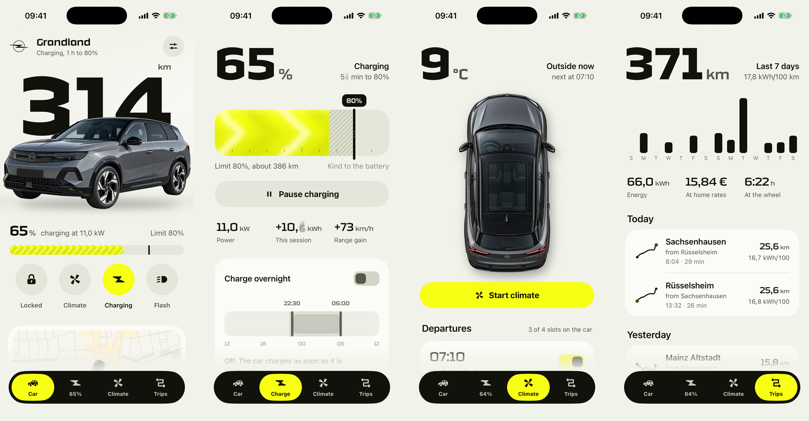
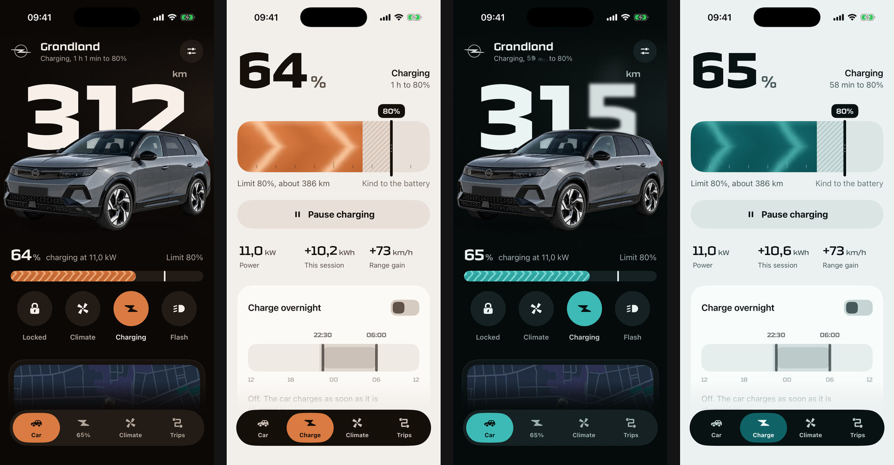

# Designing around the car

BetterOpel began with a personal need: make the everyday controls for my Grandland easier to read and more satisfying to use. The work spans interaction design, a SwiftUI component system, motion, haptics and the system surfaces around the app.

This is an independent personal project with no association with or endorsement from Opel or Stellantis.

## Give the first screen a point of view

Range is the largest thing on the screen. The car overlaps it, putting the number and the object it describes in the same composition. Battery and the four daily controls follow immediately below. Location and the last drive are secondary, further down the page.

The squared display face carries the automotive character; system text does the smaller reading. Large values scale relative to Dynamic Type styles. Supporting detail can give way when space is tight. The earlier gallery uses Technor. The public build substitutes Oxanium by Severin Meyer, which can be redistributed under the SIL Open Font License.

## Make energy something you can manipulate

The charge screen treats the battery as a single horizontal slab. The filled portion is present charge; the hatch is planned charge; the marker is the limit. Dragging the marker changes the target, with detents at familiar stopping points. A noon-to-noon timeline gives an overnight window room to cross midnight.

Charging animation belongs inside the energy, so it explains the state without moving the entire layout. Paused and finished states stop that motion.

Implementation: [`BatterySlab.swift`](../BetterOpel/Features/Charge/BatterySlab.swift), [`ScheduleStrip.swift`](../BetterOpel/Features/Charge/ScheduleStrip.swift), [`Shaders.metal`](../BetterOpel/DesignSystem/Shaders.metal).

## Let feedback agree across senses

A lock change sweeps light across the car. A flash briefly blooms the running lights. On supported hardware, a pair of tactile clicks stands in for the lock actuator. A deliberate hold precedes unlocking, while a tightening haptic cue communicates progress.

Small controls use short, damped springs. More elastic motion is reserved for release from a gesture. The ripple and several continuous effects consult Reduce Motion; this is not a claim that every motion or accessibility path has been audited.

Implementation: [`Haptics.swift`](../BetterOpel/DesignSystem/Haptics.swift), [`Motion.swift`](../BetterOpel/DesignSystem/Motion.swift), [`LensWave.swift`](../BetterOpel/DesignSystem/LensWave.swift).

## Change the atmosphere, not only the accent

Volt uses electric yellow, Copper uses a warm paint-like orange, and Petrol uses blue-green. Each theme supplies semantic roles for canvas, surfaces, wells, ink, fills and navigation. Every role has a light and dark value. Accent text and filled controls have separate tokens so a bright button colour does not have to become unreadable body text.

The theme lives in the shared App Group. Widgets reload their tokens when the selected theme changes.

## Design for latency

A remote command may take a while to reach the vehicle. The model distinguishes sending, waiting for confirmation, offline and live readings. The interface keeps the last known state available and can report an unconfirmed command.

The demo uses the same protocol boundary with a shorter, simulated command lifecycle. It makes the visual work reviewable without giving someone access to a real vehicle.

## Keep the product honest

Remote preconditioning is on/off, so climate does not show a temperature dial. Real ready-by schedules require the companion scheduler. Demo routes use public destinations near Rüsselsheim and are not a record of the author's journeys. Generated elevation and accelerated charge progress belong to the demo.

The gallery documents an earlier demo revision rather than a fresh capture of every current state. There are no measured usability or performance claims in this case study.
